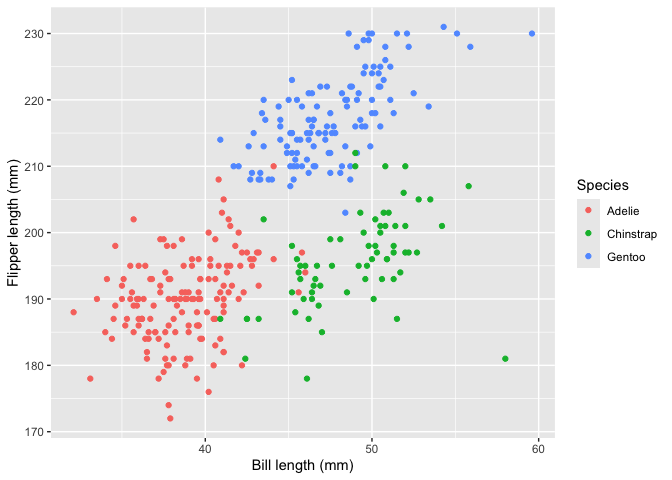

Homework 1
================
Jiaxuan Su

``` r
library(dplyr)
library(ggplot2)
```

## Problem 1

``` r
data("penguins", package = "palmerpenguins")
```

The penguins dataset has 344 rows and 8 columns. It contains data on
penguins near Palmer Station in Antarctica.

The species are Adelie, Chinstrap, Gentoo. The islands are Biscoe,
Dream, Torgersen. Other variables include bill_length_mm, bill_depth_mm,
flipper_length_mm, body_mass_g, sex, and year. Bill and flipper
measurements are in millimeters. Body mass is in grams. Sex includes
female and male, with some missing values. The years range from 2007 to
2009.

The mean flipper length is 200.92 mm. Missing values are left out.

``` r
penguin_plot = ggplot(
  penguins,
  aes(
    x = bill_length_mm,
    y = flipper_length_mm,
    color = species
  )
) +
  geom_point(na.rm = TRUE) +
  labs(
    x = "Bill length (mm)",
    y = "Flipper length (mm)",
    color = "Species"
  )

penguin_plot
```

<!-- -->

``` r
ggsave(
  filename = "penguin_scatterplot.png",
  plot = penguin_plot,
  width = 7,
  height = 5,
  units = "in",
  dpi = 300
)
```

## Problem 2

``` r
set.seed(123)

variable_types = tibble(
  normal_sample = rnorm(10),
  is_positive = normal_sample > 0,
  letter = letters[1:10],
  group = factor(
    rep(c("A", "B", "C"), length.out = 10),
    levels = c("A", "B", "C")
  )
)

variable_types
```

    ## # A tibble: 10 × 4
    ##    normal_sample is_positive letter group
    ##            <dbl> <lgl>       <chr>  <fct>
    ##  1       -0.560  FALSE       a      A    
    ##  2       -0.230  FALSE       b      B    
    ##  3        1.56   TRUE        c      C    
    ##  4        0.0705 TRUE        d      A    
    ##  5        0.129  TRUE        e      B    
    ##  6        1.72   TRUE        f      C    
    ##  7        0.461  TRUE        g      A    
    ##  8       -1.27   FALSE       h      B    
    ##  9       -0.687  FALSE       i      C    
    ## 10       -0.446  FALSE       j      A

``` r
mean(pull(variable_types, normal_sample))
```

    ## [1] 0.07462564

``` r
mean(pull(variable_types, is_positive))
```

    ## [1] 0.5

``` r
mean(pull(variable_types, letter))
```

    ## Warning in mean.default(pull(variable_types, letter)): argument is not numeric
    ## or logical: returning NA

    ## [1] NA

``` r
mean(pull(variable_types, group))
```

    ## Warning in mean.default(pull(variable_types, group)): argument is not numeric
    ## or logical: returning NA

    ## [1] NA

The mean works for normal_sample and is_positive. For is_positive, TRUE
counts as 1 and FALSE counts as 0. Its mean is the share of sample
values greater than zero.

The means of letter and group return NA with warnings. mean() does not
treat text or factors as numbers.

``` r
as.numeric(pull(variable_types, is_positive))
as.numeric(pull(variable_types, letter))
as.numeric(pull(variable_types, group))
```

TRUE becomes 1 and FALSE becomes 0, so their mean works. The letters
become NA with a warning because they cannot be read as numbers. The
factor becomes 1, 2, and 3 for A, B, and C. These numbers only label
groups, so their average is not useful. R does not use these numbers
when taking the mean of a factor without converting it first.
